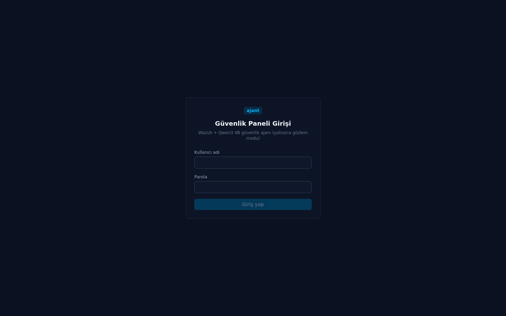
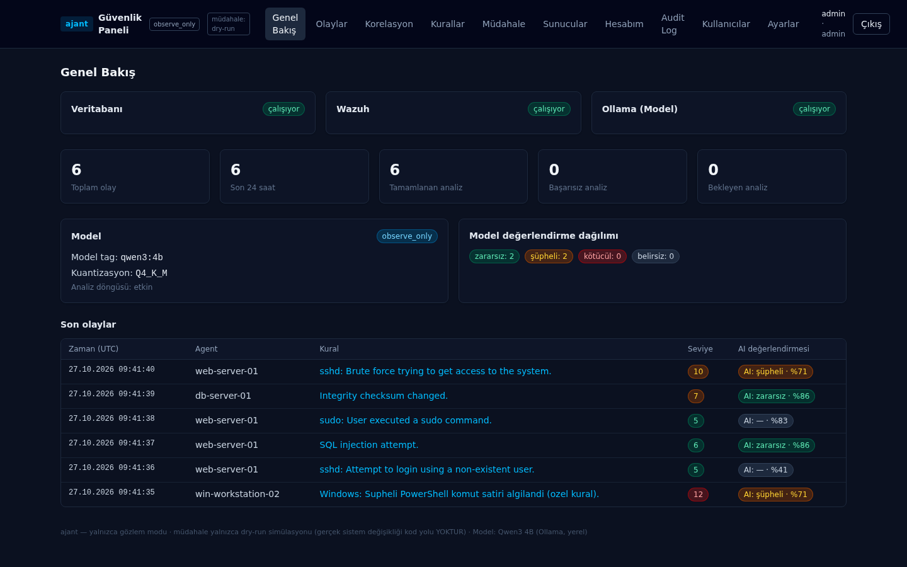
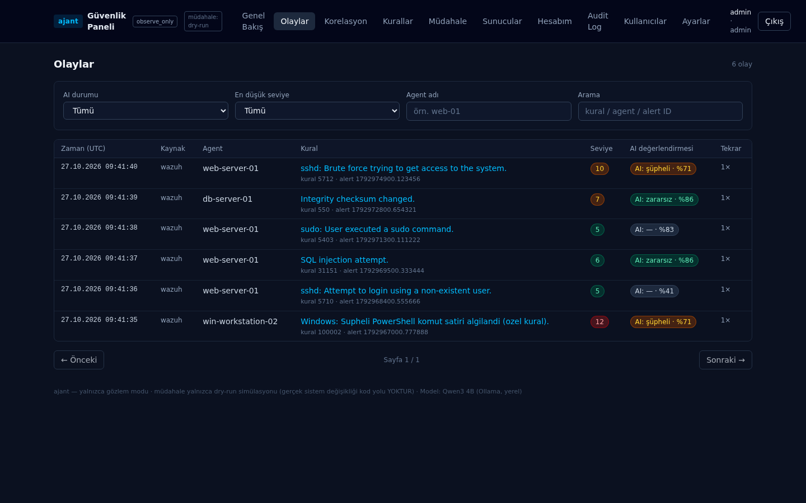
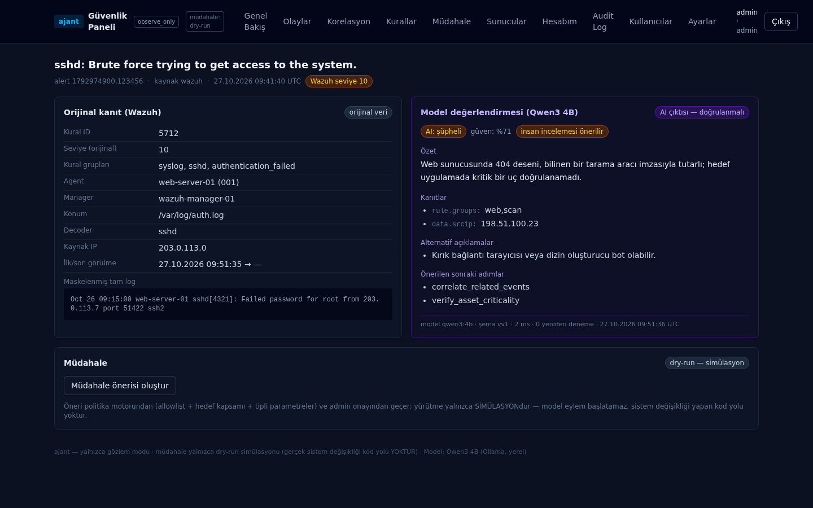
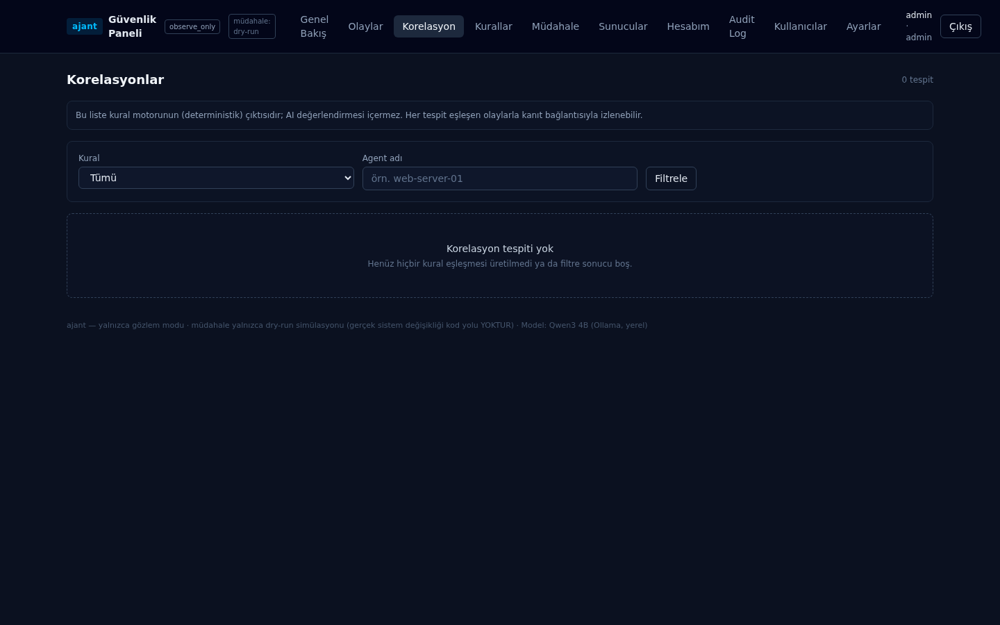
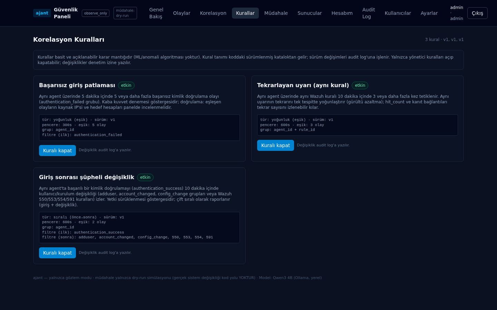
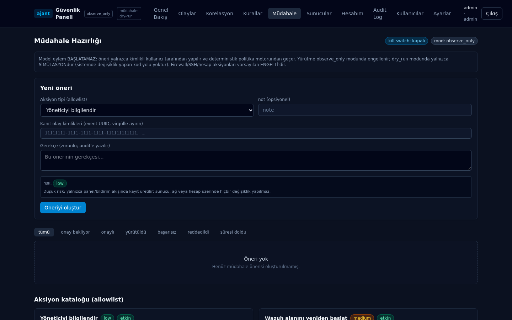
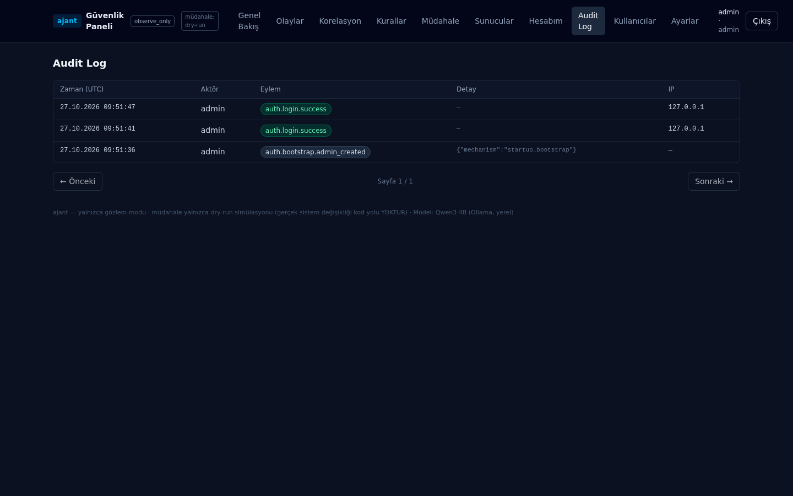
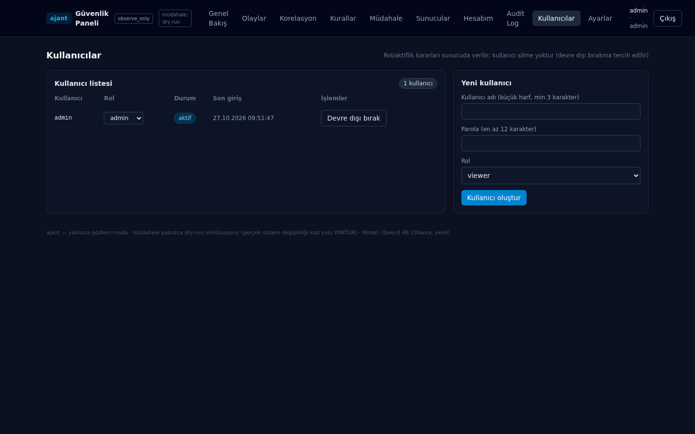
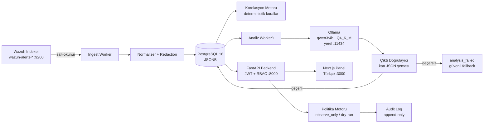

# ajant — Wazuh + Qwen3 4B Güvenlik Ajanı

Savunma odaklı güvenlik olayı analiz ajanı: Wazuh alarmlarını toplayıp,
normalleştirip/maskeledikten sonra yerel **Qwen3 4B** (Ollama) modeliyle
açıklayan/öncülendiren ve sonuçları Türkçe bir güvenlik panelinde sunan sistem.

> **Yalnızca gözlem (observe-only) modu:** Model hiçbir komut çalıştıramaz,
> hiçbir sistem değişikliği başlatamaz. Tüm model çıktıları katı JSON şemasıyla
> doğrulanır; geçersiz çıktı `analysis_failed` güvenli fallback'ine düşer ve
> panelde "güvenilir değerlendirme YOK" olarak işaretlenir. Müdahale hazırlığı
> (Faz 07) yalnızca **dry-run simülasyonudur** — sistemde değişiklik yapan kod
> yolu **mevcut değildir**.

---

## Ekran Görüntüleri

Panel tamamen **Türkçe**'dir. Aşağıdaki görüntülerde yer alan veriler tamamen
**sentetik demo verisidir** (`scripts/seed_staging_events.py`; IP'ler RFC 5737
dokümantasyon aralığındandır). Ekran görüntüleri sandbox'ta üretilmiştir; model
çıktıları gerçek model kanıtı DEĞİLDİR.

| | |
|---|---|
|  **Giriş** — JWT tabanlı panel auth |  **Genel Bakış** — bileşen sağlığı, olay/analiz sayaçları, model künyesi |
|  **Olaylar** — filtreler + AI değerlendirme rozetleri |  **Olay Detayı** — orijinal Wazuh kanıtı ↔ model değerlendirmesi ayrımı |
|  **Korelasyon** — deterministik kural motoru çıktısı |  **Kurallar** — sürümlü kural kataloğu |
|  **Müdahale** — allowlist + dry-run + kill switch |  **Audit Log** — append-only denetim kayıtları |
|  **Kullanıcılar** — RBAC rol yönetimi (admin) | |

---

## Özellikler

| Faz | Özellik | Durum |
|---|---|---|
| 00 | Keşif, mimari kararlar, STRIDE-lite tehdit modeli | ✅ |
| 01 | Proje iskeleti (FastAPI + Next.js + Alembic + structlog) | ✅ |
| 02 | Wazuh Indexer salt-okunur adapter (mock-first; gerçek Indexer API 9200) | ✅ |
| 03 | Normalizasyon, redaction (IP/e-posta maskeleme, secret desenleri), idempotent depolama, 30 gün retention | ✅ |
| 04 | Ollama/Qwen3 4B analiz worker'ı — katı şema, `analysis_failed` fallback, prompt injection savunması | ✅ |
| 05 | Güvenlik paneli (TR) — auth/RBAC, olay listesi/detayı, filtreler, durum ekranları | ✅ |
| 06 | Korelasyon — deterministik kural motoru, sürümlü katalog, kanıt bağlantıları | ✅ |
| 07 | Güvenli müdahale hazırlığı — dry-run politika motoru, allowlist, insan onayı, kill switch | ✅ |
| 08 | Sertleştirme — güvenlik başlıkları, rate limit (paylaşımlı depo), gövde limiti, yedek/geri yükleme, kullanıcı yönetimi | ✅ |
| 09 | Benchmark — donmuş holdout-v1 (48 kayıt), 3 baseline, P/R/F1/FPR/JSON-geçerlilik/latency metrikleri | ✅ |
| 10 | Dağıtım & operasyon — runbook, uçtan uca operasyon smoke'u (33 kontrol), yedek sözleşmesi, izleme eşikleri | ✅ |

---

## Mimari



Bileşen ilkeleri:

- **Wazuh adapter salt okunurdur.** Alert okuma, Indexer API (9200) üzerinden
  en az ayrıcalıklı servis hesabıyla yapılır; Wazuh Server API'de alert okuma
  endpoint'i olmadığı için bu yol bilinçli seçilmiştir (`docs/wazuh-staging.md`).
- **Mock-first geliştirme:** `WAZUH_SOURCE_MODE=mock` ile gerçek Wazuh
  olmadan uçtan uca akış çalışır; mock modu **üretimde yasaktır** (uygulama
  başlatılmaz).
- **Model yalnızca yereldir:** Ollama kapsayıcı dışında, kullanıcı makinesinde
  çalışır; backend yalnızca loopback/özel ağ adreslerine bağlanır
  (`OLLAMA_ALLOW_PUBLIC_HOST=false` varsayılan; genel FQDN yasak).
- **Tek veri tabanı:** Olaylar, analizler, korelasyon tespitleri, müdahale
  önerileri, kullanıcılar, audit ve ayarlar PostgreSQL'de (JSONB); ham log
  kopyası varsayılan olarak **saklanmaz** (`STORE_RAW_ALERT=false`).

## Güvenlik Tasarımı

| Katman | Uygulama |
|---|---|
| Prompt injection savunması | Sistem promptu sabit ve talimatlardan arındırılmış; kullanıcı verisi yalnızca maskeli bağlam bloğunda yapılandırılmış JSON olarak geçer; çıktı şeması dışına çıkan her yanıt reddedilir |
| Çıktı doğrulama | `ModelAnalysis` şeması (`extra=forbid`): 4'lü `assessment` enum'u, 0-1 `confidence`, izlenebilirlik zorlaması (`alert_ids` olayı kapsamalı) → ihlalde retry → `analysis_failed` |
| Kimlik doğrulama | JWT (access 15 dk / refresh 1 gün) + **argon2id** parola hash'i; giriş uçlarında IP başına rate limit |
| RBAC | `viewer` (salt okunur) / `analyst` (analiz + müdahale önerisi) / `admin` (kullanıcı, kural, ayar yönetimi) |
| Redaction | IP (`masked`/`redacted`), e-posta maskeleme + secret desen temizliği; model promptu tavana göre kırpılır |
| Audit | append-only denetim tablosu: giriş, rol/aktiflik, kural açma/kapama, öneri onay/yürütme, ayar değişimi |
| Kill switch'ler | `ANALYSIS_ENABLED`, `CORRELATION_ENABLED`, `REMEDIATION_ENABLED` — `/ready` içinde durum raporlanır |
| Müdahale kapıları | `observe_only` varsayılan; `dry_run` yalnızca simülasyon; firewall/SSH/hesap aksiyonları çift bağımsız kapıyla engelli; self-approval varsayılan kapalı; prod'da uygulama `observe_only` dışında modla başlamaz |
| Sertleştirme | Güvenlik başlıkları (CSP vb.), 1 MB istek gövdesi tavanı, paylaşımlı rate limit deposu, disk dolması alarmı, HSTS anahtarı |

---

## Teknoloji Yığını

| Katman | Teknoloji |
|---|---|
| Backend | Python 3.12, FastAPI 0.162, Pydantic v2 2.12.5, SQLAlchemy 2.0.55 (async), Alembic 1.20.1, structlog 25.5.0, uvicorn 0.44 |
| Veri tabanı | PostgreSQL 16 (JSONB; üretim) · SQLite/aiosqlite (geliştirme/smoke) |
| Kimlik | PyJWT 2.15.1 (HS256) + argon2-cffi 25.1.0 |
| LLM | Ollama — **`qwen3:4b`** (tag sabit; Q4_K_M, temperature 0.2, num_predict 512) |
| Panel | Next.js 15.5.28, React 19.1.0, TanStack Query 5, Tailwind CSS 4, TypeScript 5.8 |
| Dağıtım | Docker Compose (postgres:16-alpine + backend + frontend; Ollama kapsayıcı DIŞINDA) |

## Hızlı Başlangıç (Docker Compose)

Ön koşullar: Docker + Docker Compose, ayrıca **Ollama** (kapsayıcı dışında,
aynı makinede).

```bash
# 1) Ollama kur ve modeli indir (CPU modu: 32 GB RAM yeterli)
ollama pull qwen3:4b

# 2) Yapılandırma: .env örnek değerlerle oluşur — ZORUNLU alanları değiştirin
cp backend/.env.example backend/.env
#    JWT_SECRET ve ADMIN_BOOTSTRAP_PASSWORD mutlaka değiştirilmelidir.

# 3) Uygulamayı başlat (backend 127.0.0.1:8000, panel 127.0.0.1:3000)
docker compose up --build
```

Panel: `http://127.0.0.1:3000` — ilk girişte `ADMIN_BOOTSTRAP_PASSWORD`
ile oluşturulan `admin` kullanıcısı kullanılır (bootstrap yalnızca users
tablosu boşken çalışır; audit'e yazılır).

> **Ollama bağlama notu:** Kapsayıcılı kurulumda backend, Ollama'ya
> `host.docker.internal:11434` üzerinden bağlanır; Ollama'yı docker0 köprü
> IP'sine (örn. `172.17.0.1`) bağlamanız gerekebilir. Konteynersız kurulumda
> `127.0.0.1:11434` kullanılır. Doğrulama komutları:
> `docs/phase-10-operations.md` §1 ve `docs/deployment.md` §1.

## Yerel Geliştirme (Docker'sız)

Backend (SQLite ile hızlı başlangıç; üretim eşleniği PostgreSQL'dir):

```bash
cd backend
python3.12 -m venv .venv && source .venv/bin/activate
pip install -r requirements-lock.txt

export JWT_SECRET="dev-icin-32-karakterden-uzun-sahte-bir-deger-XXX"
export DATABASE_URL="sqlite+aiosqlite:////tmp/ajant_dev.db"
export ADMIN_BOOTSTRAP_PASSWORD="dev-admin-parolasi-1234"
export WAZUH_SOURCE_MODE="mock"          # gerçek Wazuh gerekmez (yalnız dev)
export OLLAMA_BASE_URL="http://127.0.0.1:11434"

python -m alembic upgrade head
uvicorn app.main:create_app --factory --port 8000
```

Frontend:

```bash
cd frontend
npm ci
NEXT_PUBLIC_API_BASE_URL=http://localhost:8000 npm run build
npm start          # http://localhost:3000
# veya geliştirme modu: npm run dev
```

### Sentetik demo verisi

Gerçek Wazuh olmadan paneli veriyle görmek için (üretim veritabanına karşı
**koşulmaz** — sentetik veri bulaşır):

```bash
# 6 sentetik alert'i ÜRETİM ingest yolundan besler (idempotent; saat-bağımsız)
python3 ../scripts/seed_staging_events.py
```

Model olmadan da sistem güvenli davranır: Ollama kapalıysa olaylar `pending`
kalır, **sahte değerlendirme yazılmaz**; model bozuk çıktı üretirse
`analysis_failed` satırları oluşur. Bu iki hata yolu
`scripts/fake_ollama_server.py` (yalnız test düzeneği) ile kanıtlanmıştır.

---

## Ortam Değişkenleri (seçme)

Tam liste ve varsayılanlar: `backend/.env.example` (tüm değerler sahte örnektir).

| Değişken | Varsayılan | Açıklama |
|---|---|---|
| `JWT_SECRET` | — (zorunlu) | En az 32 karakter; sahte varsayılan yoktur |
| `DATABASE_URL` | — (zorunlu) | `postgresql+asyncpg://…` veya geliştirmede `sqlite+aiosqlite:///…` |
| `ADMIN_BOOTSTRAP_PASSWORD` | boş | Users tablosu boşsa `admin` kullanıcısı bu parolayla oluşturulur |
| `WAZUH_SOURCE_MODE` | `indexer` | `mock` yalnızca geliştirme; prod'da mock ile başlatma YASAK |
| `WAZUH_INDEXER_URL` | boş | `https://…:9200` (salt-okunur servis hesabı: `docs/wazuh-staging.md`) |
| `OLLAMA_BASE_URL` | `http://localhost:11434` | Yalnızca loopback/özel ağ; genel host `false` gerektirir |
| `OLLAMA_MODEL_TAG` | `qwen3:4b` | Sabitlenmiş model tag'i |
| `ANALYSIS_ENABLED` | `true` | Analiz kill switch (`/ready`: `disabled`) |
| `WORKER_LOOP_ENABLED` | `false` | Birleşik arka plan döngüsü (fetch → store → analyze) |
| `POLICY_MODE` | `observe_only` | `dry_run` simülasyon modu; "gerçek yürütme" KODDA YOKTUR |
| `REMEDIATION_ENABLED` | `true` | Müdahale önerisi/yürütme kill switch |
| `RETENTION_DAYS` | `30` | Olay saklama süresi |
| `RATE_LIMIT_BACKEND` | `memory` | Çok prosesli dağıtımda `database` |
| `MAX_REQUEST_BODY_BYTES` | `1048576` | 1 MB gövde tavanı (aşım → 413) |

## API Uçları (özet; önek `/api/v1`)

| Metot ve yol | Yetki | Açıklama |
|---|---|---|
| `GET /health`, `GET /ready` | herkese açık | Yaşam + bileşen sağlığı (database/wazuh/ollama/disk) |
| `POST /auth/login`, `POST /auth/refresh`, `GET /auth/me` | — | JWT giriş/yenileme/kimlik |
| `GET /overview` | viewer | Panel genel bakış sayaçları |
| `GET /events`, `GET /events/{id}` | viewer | Olay listesi (filtre/sayfa) ve detay (orijinal kanıt + AI değerlendirmesi) |
| `GET /correlations`, `GET /correlations/{id}`, `GET /correlation-rules` | viewer | Korelasyon tespitleri ve sürümlü kural kataloğu |
| `GET /agents` | viewer | Wazuh ajan özeti |
| `GET /remediation/catalog`, `GET /remediation/actions[/{id}]` | viewer | Allowlist kataloğu ve öneri listesi |
| `POST /remediation/actions` | analyst | Yeni müdahale önerisi (gerekçe zorunlu; audit'e yazılır) |
| `POST /remediation/actions/{id}/approve` · `/reject` · `/execute` | analyst/admin | İnsan onayı ve **yalnızca simülasyon** yürütme |
| `GET /audit` | admin | Append-only denetim kayıtları |
| `GET/POST /users`, `PATCH /users/{id}`, `POST /users/{id}/password` | admin | Kullanıcı yönetimi (silme yok; devre dışı bırakma tercih edilir) |
| `GET /settings` | admin | Etkin çalışma zamanı ayarları (secret gösterilmez) |

### AI analiz sözleşmesi (özet)

Model çıktısı aşağıdaki katı şemayla doğrulanır; ekstra alan, yanlış enum,
aralık dışı confidence veya olayı kapsamayan `alert_ids` → retry →
`analysis_failed`:

```json
{
  "schema_version": 1,
  "alert_ids": ["1792974900.123456"],
  "summary": "Kanıta dayalı kısa açıklama",
  "assessment": "suspicious",
  "confidence": 0.72,
  "evidence": [{"field": "rule.id", "value": "5712"}],
  "alternative_explanations": ["Meşru otomasyon olabilir"],
  "recommended_next_steps": ["review_full_logs"],
  "requires_human_review": true
}
```

`assessment` enum'u: `benign` · `suspicious` · `likely_malicious` ·
`inconclusive`. `confidence` kalibre edilmiş olasılık DEĞİLDİR — modelin öz
değerlendirmesidir (Faz 09 ölçümüyle desteklenir). Wazuh'un orijinal
severity/rule alanları asla değiştirilmez; model değerlendirmesi panelde
her zaman **ayrı** gösterilir ("AI çıktısı — doğrulanmalı" rozeti).

---

## Testler ve Kalite Kapıları

| Kapı | Sonuç | Kapsam |
|---|---|---|
| `pytest` | **641/641** | Birim + entegrasyon (auth, redaction, worker, korelasyon, politika, API sözleşmeleri) |
| `ruff check` | temiz | Lint (repo geneli) |
| `mypy` | temiz (87 dosya) | Tip denetimi |
| `vitest run` | **31/31** | Panel bileşen/durum testleri |
| `scripts/secret_scan.sh` | temiz | Repo genelinde secret deseni taraması |
| `scripts/phase10_smoke.sh` | **33/33** ×2 | Uçtan uca operasyon smoke'u: kurulum, idempotent besleme, model-kesik güvenli davranış, bozuk-çıktı fallback, Wazuh kesintisi, kill switch, yedek sözleşmesi |

Her faz ayrıca bağımsız doğrulayıcı tarafından TEST-PROMPT-TEMPLATE ile
denetlenmiştir; bulgular (`docs/phase-*-verification.md`) kapatılarak
commit'lenmiştir.

## Benchmark (Faz 09)

- Donmuş veri kümesi **holdout-v1**: 48 kayıt (sentetik, etiketli senaryolar).
- Karşılaştırılan 3 baseline: `rules_only`, `qwen_prompt_only`,
  `rules_corr_qwen`.
- Metrikler: Precision / Recall / F1 / FPR, JSON geçerlilik oranı, kanıt
  kalitesi, latency, injection direnci; sonuçlar provenance künyesiyle
  (model tag, quantization, veri kümesi sürümü, tarih) raporlanır.
- Karar: **fine-tuning şimdilik ertelenir** (alınamayan kazanç dengesi);
  ayrıntı ve koşum komutları: `docs/phase-09-benchmark.md`.
- Önemli: benchmark sonuçları repoya **girmez**
  (`backend/benchmarks/results/` gitignore'dadır).

> Bu repodaki tüm model-etkileşimli kanıtlar (testler, smoke, ekran
> görüntüleri) sandbox'ta üretildiği için **gerçek model kanıtı değildir**;
> gerçek model doğrulaması kullanıcı makinesi koşumlarına aittir
> (`docs/phase-10-operations.md` §12).

## Operasyon

| Belge | İçerik |
|---|---|
| `docs/phase-10-operations.md` | Sürüm matrisi, A-J kurulum akışı (beklenen çıktılarla), Ollama/Wazuh/health doğrulamaları, **alarm eşik tablosu**, **kesinti davranış matrisi**, upgrade/rollback kontrol listesi, bakım takvimi, sandbox NOT-RUN komut listesi |
| `docs/deployment.md` | Prod dağıtım: TLS reverse proxy, ortam sertleştirme, yedekleme zamanlaması |
| `docs/incident-runbook.md` | 9 senaryo: model bozuk çıktı, Ollama kesintisi, Wazuh kesintisi, disk dolması, brute-force girişimi vb. |
| `docs/remediation-runbook.md` | Dry-run müdahale akışı, onay penceresi, rollback |
| `docs/wazuh-staging.md` | Salt-okunur Wazuh Indexer servis hesabı kurulumu |
| `scripts/backup_db.sh` · `restore_db.sh` | pg_dump yedeği (yarım dump bırakmaz — EXIT trap) + onaylı geri yükleme |

Yedek / geri yükleme sözleşmesinin Docker'sız davranışı (fail-fast, artık
yok) Faz 10 smoke'unun 7. evresinde kanıtlanmıştır; gerçek pg_dump/restore
kullanıcı makinesinde koşulmalıdır.

## Depo Haritası

```
ajant/
├── backend/
│   ├── app/
│   │   ├── api/v1/          # REST uçları (auth, events, correlations, remediation, users, audit, …)
│   │   ├── core/            # config, db, logging (structlog), middleware
│   │   ├── models/          # SQLAlchemy modelleri (event, analysis, correlation, remediation, user, audit, rate_limit)
│   │   ├── services/        # wazuh, normalization, analysis, correlation, remediation, security
│   │   └── workers/         # ingest / analysis / correlation / birleşik döngü
│   ├── alembic/             # 0001…0006 migrasyonları
│   ├── benchmarks/          # Faz 09 benchmark altyapısı (holdout-v1, baseline'lar, CLI)
│   └── tests/               # 641 test
├── frontend/
│   └── src/app/             # login, genel bakış, olaylar, korelasyon, kurallar, müdahale,
│                            #   sunucular, hesabım, audit, kullanıcılar, ayarlar (TR)
├── docs/                    # faz doğrulama raporları + operasyon/runbook belgeleri
├── scripts/                 # smoke testleri, seed, fake Ollama, yedek/geri yükleme, secret_scan
├── phases/ · skills/ · training/   # starter pack (proje yönetim şablonları)
├── docker-compose.yml       # postgres:16-alpine + backend (127.0.0.1:8000) + frontend (127.0.0.1:3000)
└── AGENTS.md                # geliştirme ve güvenlik kuralları (repo anayasası)
```

## Güvenlik Notları

- `.env` asla repoya eklenmez (`secret_scan.sh` CI kapısıdır); `.env.example`
  yalnızca sahte örnek değerler içerir.
- Loglar JSON yapılandırılmıştır; password/token/secret alanları otomatik
  maskelenir. Model promptu yalnızca **maskelenmiş** bağlam taşır.
- Panelde secret gösterilmez; erişim tokenları `localStorage`'da tutulur
  (CSRF yüzeyi yok — her istekte elle Bearer başlığı; XSS'e karşı React
  metin kaçışı + `dangerouslySetInnerHTML` yasağı testle denetlenir).
- Wazuh adapter salt-okunur, en az ayrıcalıklı hesapla çalışır; mock modu
  üretimde başlatılamaz.
- Model hiçbir aksiyon başlatamaz: öneriler politika motorunun allowlist'inden
  geçer, insan onayı ister ve yürütme observe_only'de engelli, dry_run'da
  simülasyondur — sistemde değişiklik yapan kod yolu yoktur.
