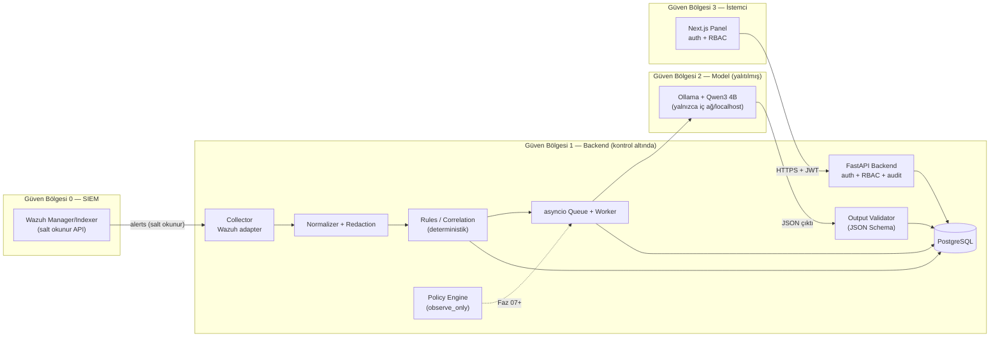

# Faz 00 — Keşif ve Tasarım Raporu

**Proje:** ajant — Wazuh + Qwen3 4B Security Agent
**Tarih:** 2026-10-27
**Durum:** Proje sahibi onayı bekleniyor
**Paket kuralı:** Bu fazda kod/config değişikliği YOKTUR; yalnızca analiz ve tasarım dokümanı üretilmiştir.

---

## 0. Proje Sahibi Kararları (Onaylı)

Aşağıdaki kararlar 2026-10-27'de proje sahibiyle netleştirilmiştir ve Faz 01+ geliştirmenin temelini oluşturur.

| Karar Alanı | Seçim | Not |
|---|---|---|
| Backend | Python 3.12 + FastAPI | Pydantic v2 ile katı JSON şema doğrulama |
| Güvenlik paneli | Next.js + React | shadcn/ui ile 6 ekranlı panel |
| Veritabanı | PostgreSQL | JSONB + güçlü indeksleme |
| Kuyruk/Worker | asyncio iç worker | Tek süreç başlangıcı; Celery'ye geçiş noktası korunacak |
| Gerçek ortam | Yalnızca Ollama mevcut | Wazuh: mock adapter + sentetik fixture ile geliştirme |
| Panel dili | Türkçe | Proje sahibi kararı (2026-10-27) |
| Donanım hedefi | 32 GB RAM DDR4, 2 GB VRAM GPU | 2 GB VRAM model yükleme için yetersiz → Ollama **CPU modunda**; Q4_K_M quantization önerilir |
| Dağıtım | Docker Compose | Non-root, pinlenmiş imajlar |
| Depo konumu | Bu depo (ajant) kökü | Starter pack belgeleri köke taşındı |
| Rapor biçimi | Sohbet + MD | `docs/phase-00-discovery.md` |

---

## 1. Repo ve Ortam Envanteri

### 1.1 Depo durumu

- Git: `main` dalı, son commit `8b14722` ("Add files via upload"), temiz çalışma kopyası.
- İçerik: starter pack belgeleri repo köküne taşındı (`AGENTS.md`, `architecture.md`, `acceptance-matrix.md`, `phases/`, `skills/`, `training/`); orijinal ZIP arşivi referans için korunuyor.
- **Mevcut uygulama kodu yok** — proje sıfırdan kurulacaktır. Bu nedenle Faz 00'ın "teknoloji yığını seçimi için gerekçeli seçenekler sun" gereksinimi, proje sahibiyle yapılan karar oturumuyla yerine getirilmiştir (bkz. Bölüm 0 ve 3).

### 1.2 Geliştirme ortamı (mevcut sandbox)

| Araç | Sürüm | Durum |
|---|---|---|
| Python | 3.12.15 | ✓ mevcut |
| pip | 25.0.1 | ✓ mevcut |
| Node.js | 24.21.0 | ✓ mevcut |
| npm | 11.19.0 | ✓ mevcut |
| Docker / Docker Compose | — | ✗ sandbox'ta yok |
| Ollama | — | ✗ sandbox'ta yok |
| CPU / RAM | 2 vCPU / 4,1 GB | Qwen3 4B yerel çalıştırma için yetersiz |

### 1.3 Kullanıcı ortamı (hedef dağıtım)

- **Ollama:** kullanıcı makinesinde mevcut (sürüm doğrulanacak); model tag'i `qwen3:4b` olarak sabitlenecek.
- **Donanım (proje sahibi, 2026-10-27):** 32 GB RAM DDR4 + 2 GB VRAM eski GPU. 2 GB VRAM, Qwen3 4B modelini yüklemek için yetersizdir (Q4 quantization ≈ 2,6 GB VRAM ister); bu nedenle Ollama **CPU modunda** çalışacaktır (Q4_K_M ≈ 2,6 GB disk, çıkarım RAM'de). 32 GB RAM bunun için yeterlidir. CPU çıkarım hızı düşük olsa da analizler async kuyrukta arka planda işlendiği için kabul edilebilirdir.
- **Wazuh:** henüz yok. Faz 02'de tam fonksiyonlu **mock adapter** ve sentetik alert fixture'larıyla geliştirme yapılacak; gerçek Wazuh bağlantısı, sürüm doğrulaması ve salt okunur servis hesabı kurulumu erişim sağlandığında staging'de test edilecektir.
- **Sonuç:** Geliştirme stratejisi "mock-first"dir. Hem Wazuh hem Ollama arayüzleri soyutlanacak (`adapter pattern`), testlerde mock, gerçek ortamda aynı sözleşmeyi konuşan gerçek istemci kullanılacaktır. Sandbox'ta Docker bulunmadığı için Dockerfile/compose dosyaları yazılacak ancak compose doğrulaması kullanıcı makinesinde yapılacaktır; Python/Node tabanlı tüm birim ve entegrasyon testleri bu ortamda koşturulabilir.

---

## 2. Bağlam ve Veri Akışı Diyagramı



**Akışın ana maddeleri:**

1. Wazuh alarmı collector tarafından salt okunur API üzerinden alınır; kimlik bilgisi yalnızca backend'de yaşar.
2. Normalizer, alarmı sürümlü ortak event modeline çevirir; orijinal `alert_id`, UTC zaman, agent ve rule/severity alanları **değiştirilmeden** korunur; hassas alanlar redaction politikasına göre maskelenir.
3. Deterministik korelasyon katmanı bilinen eşleşmeleri değerlendirir — olay ilişkilendirme LLM'e delege edilmez.
4. Kuyruğa alınan olaylar idempotent işlenir; tekrar gelen alarm aynı analizi çoğaltmaz.
5. Worker, doğrulanmış ve sınırlandırılmış event bağlamını Ollama'daki Qwen3 4B'ye gönderir; log içeriği **güvenilmeyen veri** olarak işaretlenir.
6. Model çıktısı katı JSON şemasıyla doğrulanır; geçersizse sınırlı tekrar ve ardından `analysis_failed` güvenli fallback'i uygulanır.
7. Analiz, orijinal Wazuh severity'sine yazılmadan ayrı `ai_assessment` alanında DB'ye kaydedilir.
8. Panel, kimlik doğrulamalı kullanıcıya olayları, AI değerlendirmelerini ve audit kayıtlarını gösterir; AI alanları görsel olarak ayırt edilir.
9. Faz 07'ye kadar herhangi bir otomatik müdahale yolu **mevcut değildir**; policy engine yalnızca gözlem/öneri modundadır.

---

## 3. Önerilen Teknoloji Yığını ve Gerekçesi

| Katman | Teknoloji | Sürüm politikası | Gerekçe |
|---|---|---|---|
| Backend dil/çatı | Python + FastAPI | Python 3.12, FastAPI son kararlı, pinlenmiş | Pydantic v2 ile AI sözleşmesinin katı doğrulaması doğal biçimde çözülür; async destekli; Ollama/AI ekosistemiyle uyumlu |
| Şema doğrulama | Pydantic v2 | pinlenmiş | JSON Schema üretimi, enum kontrolü, tip güvenliği; Output Validator'ın çekirdeği |
| ORM / migration | SQLAlchemy 2 + Alembic | pinlenmiş | Sürümlü migration, geri dönüş yolu; JSONB desteği |
| Veritabanı | PostgreSQL 16 | pinlenmiş imaj | JSONB ile alert metadata; kısmi ve bileşik indeksler; üretim standardı |
| Kuyruk | asyncio iç worker (DB-tabanlı görev tablosu) | — | Ek altyapı yok; kuyruk arayüzü soyutlanarak Faz 08+ ölçek ihtiyacında Celery/Redis'e geçiş yolu açık kalır |
| Wazuh entegrasyonu | httpx (async) | pinlenmiş | Timeout, retry/backoff, circuit breaker kolay; adapter soyutlaması ile mock üretimi basit |
| Model sunumu | Ollama REST API | kullanıcı makinesinde; model tag `qwen3:4b` config'de sabit | Yerel çıkarım; veri dışarı çıkmaz |
| Kimlik doğrulama | JWT (kısa ömürlü) + refresh rotasyonu; argon2id şifre hash'i | pinlenmiş | Panel için basit, denetlenebilir; RBAC Faz 05'te tamamlanır |
| Panel | Next.js + React + shadcn/ui + TanStack Query | pinlenmiş | 6 ekranlı panelin hızlı gelişimi; erişilebilirlik ve form desteği; XSS'e karşı güvenli render varsayılan |
| Loglama | structlog (JSON) + correlation/request ID | pinlenmiş | Yapılandırılmış, redaction-uyumlu loglar |
| Test | pytest + pytest-asyncio + respx (mock HTTP); vitest + Playwright (panel) | pinlenmiş | Negatif testler ve sözleşme testleri için uygun |
| Lint/statik analiz | ruff + mypy | pinlenmiş | Tek araçta hızlı lint; tip kontrolü |
| Dağıtım | Docker Compose | non-root, pinlenmiş imajlar | Tek komutla backend + DB (+opsiyonel Ollama); kullanıcı makinesinde doğrulanır |

**Bilinçli olarak yapılmayacaklar (Faz 01 itibarıyla):** Wazuh bağlantısı, LLM çağrısı ve remediation modülleri iskelette **bağlantı yapmadan** yalnızca arayüz/stub olarak yer alacak; uygulama güvenli varsayıllarla açılacak (bkz. `phases/01-project-skeleton.md`).

### 3.1 Önerilen klasör yapısı (Faz 01'de kurulacak)

```text
ajant/
├── backend/
│   ├── app/
│   │   ├── main.py              # FastAPI uygulaması
│   │   ├── core/                # config doğrulama, güvenlik, loglama
│   │   ├── api/v1/              # router'lar (health, auth, alerts, ...)
│   │   ├── models/              # SQLAlchemy modelleri
│   │   ├── schemas/             # Pydantic: event modeli + AI sözleşmesi
│   │   ├── services/            # wazuh adapter, normalizer, ollama client, validator
│   │   └── workers/             # asyncio queue/worker
│   ├── alembic/                 # migration'lar
│   ├── tests/                   # unit + entegrasyon + sözleşme testleri
│   ├── pyproject.toml
│   └── .env.example             # sahte değerler
├── frontend/                    # Next.js panel (Faz 05)
├── docs/                        # keşif raporu ve faz raporları
├── phases/, skills/, training/  # starter pack (mevcut)
├── docker-compose.yml
├── AGENTS.md, architecture.md, acceptance-matrix.md
└── README.md
```

---

## 4. Tehdit Modeli ve Güven Sınırları

### 4.1 Güven sınırları

1. **Wazuh ↔ Backend:** Dış sınır. Yalnızca salt okunur, en az ayrıcalıklı servis hesabı; backend Wazuh'a hiçbir koşulda yazma çağrısı yapmaz (mock adapter da bu sözleşmeye uyar).
2. **Log içeriği → Model:** Güvenilmeyen girdi. Alert/event alanlarındaki her metin (kullanıcı adı, süreç adı, komut satırı vb.) potansiyel prompt injection taşıyıcısıdır; talimat olarak işlenmez, yalnızca veri olarak modele sunulur.
3. **Model → Backend:** Güvenilmeyen çıktı. Her yanıt katı JSON şemasından geçer; doğrulama başarısızsa `analysis_failed` fallback'i.
4. **Kullanıcı → Panel/API:** Kimlik doğrulama + RBAC + sunucu tarafı yetkilendirme; doğrudan ID ile erişim denemelerinde bile yetki kontrolü zorunlu.
5. **Ollama ↔ Ağ:** Yalnızca localhost/iç ağ; internete açık endpoint yasak (Faz 08'de port doğrulaması).
6. **Ajanın kendine erişimi:** Ajan kendi loglarını, audit kayıtlarını ve güvenlik kontrollerini silemez/değiştiremez; kendi erişimini kesebilecek eylemler varsayılan olarak engellenir.

### 4.2 Tehdit listesi (STRIDE-lite)

| Tehdit | Örnek senaryo | Planlanan kontrol |
|---|---|---|
| Spoofing | Çalıntı oturum belirteciyle panel erişimi | Kısa ömürlü access token, refresh rotasyonu, giriş rate limit |
| Tampering | Model çıktısının Wazuh severity'sini ezmesi | `ai_assessment` ayrı alan; orijinal alanlar immutable |
| Repudiation | "Ben o değişikliği yapmadım" inkârı | Append-only audit log: kim, ne zaman, gerekçe, hedef |
| Information disclosure | Secret'ın loga/frontend'e sızması | Secret'lar yalnızca env/secret store; redaction; log hijyeni testleri |
| Denial of Service | Alert fırtınası / Ollama yavaşlaması | Kuyruk + concurrency sınırı + timeout + circuit breaker + backpressure |
| Elevation of Privilege | Modelin serbest komut çalıştırması | İlk sürümde hiçbir exec yolu yok; Faz 07'de dry-run + allowlist + insan onayı |
| Prompt injection | Log gömülü "önceki talimatları yok say" | Talimat/veri ayrımı, sistem promptu sabit, negatif test fixture'ları (Faz 04) |

---

## 5. API / Veri Sözleşmesi Taslağı

> Bu taslak Faz 01-04'te Pydantic şemalarına ve OpenAPI belgelerine dönüşecektir. Alan adları `architecture.md` içindeki AI analiz sözleşmesiyle uyumludur.

### 5.1 REST API taslağı (v1)

| Endpoint | Metot | Min. rol | Açıklama |
|---|---|---|---|
| `/api/v1/health` | GET | — | Liveness |
| `/api/v1/ready` | GET | — | Readiness: DB, Wazuh bağlantı durumu, Ollama durumu |
| `/api/v1/auth/login` | POST | — | Kullanıcı girişi → access/refresh |
| `/api/v1/auth/refresh` | POST | auth | Token yenileme |
| `/api/v1/alerts` | GET | viewer | Filtre + sayfalama; zaman, kaynak, rule, severity, ai_assessment |
| `/api/v1/alerts/{id}` | GET | viewer | Olay detayı + kanıt alanları |
| `/api/v1/analyses/{alert_id}` | GET | viewer | AI analiz sonucu + metadata (model tag, prompt sürümü, süre) |
| `/api/v1/servers` | GET | viewer | Agent/server son görülme + health |
| `/api/v1/audit` | GET | admin | Audit kayıtları (salt okunur) |
| `/api/v1/settings` | GET/PUT | admin | Model endpoint/tag, retention, redaction; secret değerleri hiçbir zaman döndürülmez |

### 5.2 Normalize edilmiş event modeli (taslak)

```json
{
  "schema_version": "1.0",
  "event_id": "uuid (idempotency key)",
  "alert_id": "wazuh-orijinal-id",
  "occurred_at_utc": "2026-01-01T12:00:00Z",
  "collected_at_utc": "...",
  "agent": {"id": "...", "name": "...", "server": "..."},
  "rule": {"id": "...", "level": 10, "description": "..."},
  "wazuh_severity_original": 10,
  "ai_assessment": null,
  "redacted_context": { "...": "yalnızca beyaz liste alanlar, maskeli" },
  "correlation": {"matched_rules": [], "related_alert_ids": []}
}
```

### 5.3 AI analiz sözleşmesi

`architecture.md` içindeki şema benimsenmiştir: `schema_version`, `alert_ids`, `summary`, `assessment` (`benign | suspicious | likely_malicious | inconclusive`), `confidence` (kalibre edilmemiş öz değerlendirme), `evidence[]`, `alternative_explanations[]`, `recommended_next_steps[]` (yalnızca tanımlı güvenli türler), `requires_human_review`. Geçersiz çıktı → sınırlı tekrar → `analysis_failed` kaydı.

### 5.4 Veritabanı tablo taslağı

| Tablo | Amaç |
|---|---|
| `users`, `roles` | Kimlik + RBAC (viewer / analyst / admin) |
| `alerts` | Normalize edilmiş alarm referansları (ham log kopyası yok) |
| `analyses` | AI çıktısı + model/prompt/süre metadata + durum (`pending/ok/analysis_failed`) |
| `correlation_matches` | Kural sürümü + eşleşen olay bağlantıları |
| `audit_log` | Append-only eylem kaydı |
| `settings` | Yapılandırma (secret değerleri içermez) |
| `jobs` | Kuyruk görev tablosu (idempotency + durum) |

---

## 6. Test Stratejisi

- **Piramit:** birim testleri → entegrasyon (mock Wazuh/mock Ollama) → sözleşme/şema testleri → güvenlik testleri → uçtan uca (panel için Playwright).
- **Sözleşme testleri:** mock adapter'ların gerçek istemcilerle aynı Pydantic şemalarını üretmesi; gerçek Wazuh erişimi geldiğinde aynı testlerin staging'de koşulması.
- **Zorunlu negatif senaryolar** (paket gereği): prompt injection içeren log, bozuk JSON, eksik/ekstra alan, yanlış enum, timeout, Wazuh API 401/403/429/5xx, Ollama kapalı, DB kesintisi, yetkisiz erişim, rate limit, duplicate alert, migration rollback.
- **Ölçülebilir başarı ölçütleri:** schema-valid rate, p50/p95 latency, hata oranı; Faz 09'da precision/recall/F1/FPR.
- **Kapsam hedefi:** backend kritik yollar %80+; şema doğrulama yolları %100.
- **Komutlar:** `pytest`, `ruff check`, `mypy`, `npm run lint && npm test` (panel).

---

## 7. Açık Sorular ve Riskler

### 7.1 Açık sorular — karara bağlananlar (2026-10-27 güncellemesi)

| # | Soru | Sonuç |
|---|---|---|
| 1 | Gerçek Wazuh erişimi ve sürümü | **AÇIK** — erişim henüz yok; Faz 02 mock adapter ile geliştirme sürüyor |
| 2 | Donanım / quantization | **KAPANDI** — 32 GB RAM DDR4, 2 GB VRAM GPU → Ollama CPU modu, `qwen3:4b` + Q4_K_M önerilir |
| 3 | Panel dili | **KAPANDI** — Türkçe |
| 4 | Kullanıcı/rol seti | **Güvenli varsayılan** — 3 rol: viewer (görüntüleme), analyst (değerlendirme), admin (yönetim); ilk admin hesabı `.env` ile oluşturulur |
| 5 | Retention | **Güvenli varsayılan** — 30 gün (Faz 03'te yapılandırılabilir) |
| 6 | Secret yönetimi | **Güvenli varsayılan** — `.env` + Docker Compose env_file; Faz 08'de secret manager değerlendirmesi |

### 7.2 Riskler ve azaltım stratejileri

| ID | Risk | Etki | Azaltım |
|---|---|---|---|
| R1 | Mock Wazuh'tan gerçek Wazuh'a geçişte alan/endpoint uyumsuzluğu | Faz 02 gecikmesi | Adapter sözleşme testleri; sürüm doğrulaması; alan beyaz listesi |
| R2 | Qwen3 4B kalitesinin hedefleri tutturamaması | Yanlış pozitif/negatif | Önce prompt+kural taban çizgisi; Faz 09 benchmark; fine-tuning yalnızca ölçüm sonrası |
| R3 | Tek süreç asyncio worker'ın ölçek sınırı | Yüksek hacimde gecikme | Kuyruk arayüzü soyut; DB tabanlı idempotent görev tablosu; Celery'ye geçiş yolu |
| R4 | Sandbox'ta Docker/Ollama yok | Compose doğrulaması gecikir | Compose kullanıcı makinesinde doğrulanır; kod testleri mock ile burada koşar |
| R5 | Paket içi isim karışıklığı ("Qwen4B" dosya adları vs "Qwen3 4B" içerik) | Yanlış model kurulması | Karar: Ollama tag `qwen3:4b` config'de sabitlenir; dokümanlarda bu tag referans alınır |

---

## 8. Fazlara Bölünmüş Görev Listesi

| Faz | Ana görevler | Kabul ölçütü kaynağı |
|---|---|---|
| 01 İskelet | Backend/frontend iskeleti, config doğrulama, health/ready, structlog, Alembic altyapısı, `.env.example`, lint/test komutları, Docker Compose taslağı | `acceptance-matrix.md` Faz 01 |
| 02 Wazuh | Adapter arayüzü + mock, timeout/retry/circuit breaker, pagination, sentetik fixture'lar, sözleşme testleri | Faz 02 |
| 03 Normalizasyon | Event modeli v1, redaction politikası, idempotency, tablolar + indeksler, retention ayarı | Faz 03 |
| 04 Qwen analizi | Ollama istemcisi, prompt şablonu (v1), Output Validator, worker, `analysis_failed` fallback, injection testleri | Faz 04 |
| 05 Panel | Auth + RBAC, 6 ekran, filtre/sayfalama, loading/empty/error durumları, XSS güvenli render, audit ekranı | Faz 05 |
| 06 Korelasyon | Zaman penceresi kuralları, kanıt bağlantıları, kural sürümü, sentetik senaryo testleri | Faz 06 |
| 07 Müdahale hazırlığı | Dry-run policy engine, tipli action enum, allowlist, onay + audit + kill switch (fake executor) | Faz 07 |
| 08 Hardening | TLS, non-root, segmentasyon, backup/restore, secret/dependency tarama, rate limit | Faz 08 |
| 09 Benchmark | Sabit holdout seti, baseline'lar, ölçüm altyapısı, CSV/JSON rapor | Faz 09 |
| 10 Dağıtım | Runbook, staging doğrulaması, smoke test, rollback dokümanı | Faz 10 |

Her fazda: önce geliştirme promptu uygulanır, ardından `TEST-PROMPT-TEMPLATE.md` temelinde bağımsız doğrulama yapılır; testler geçmeden sonraki faza geçilmez.

---

## 9. Faz 00 Doğrulama Sonucu

- `git status`: yalnızca starter pack taşınması ve `docs/phase-00-discovery.md` eklendi; **uygulama kodu değişikliği yok** → `PASS`.
- Risk kontrol listesi: model komut çalıştırması (AGENTS.md §4 kapsıyor), prompt injection (Faz 04 negatif testleri), secret sızıntısı (§4.1-4), yetki ayrımı (Faz 05 RBAC), yanlış pozitifler (Faz 09 ölçümü), Wazuh/Ollama kesintisi (Faz 02/04 circuit breaker + fallback), tenant izolasyonu (tek kiracı — N/A), yedek/rollback (Faz 08/10).
- **Önerilen durum:** Faz 00 `PASS` — Faz 01'e geçiş için proje sahibi onayı bekleniyor.

